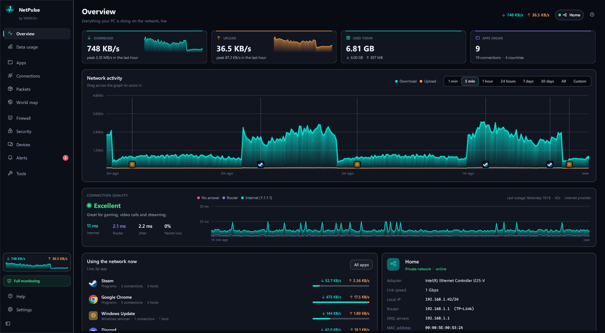
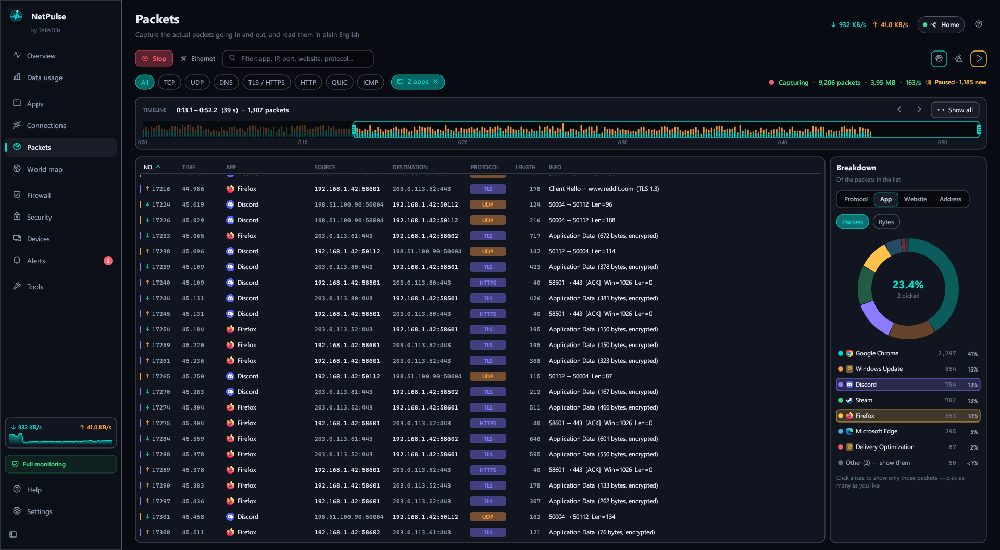
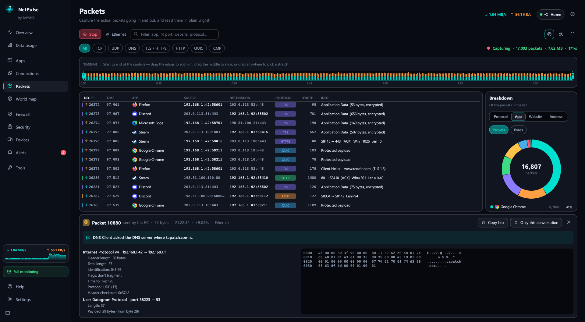
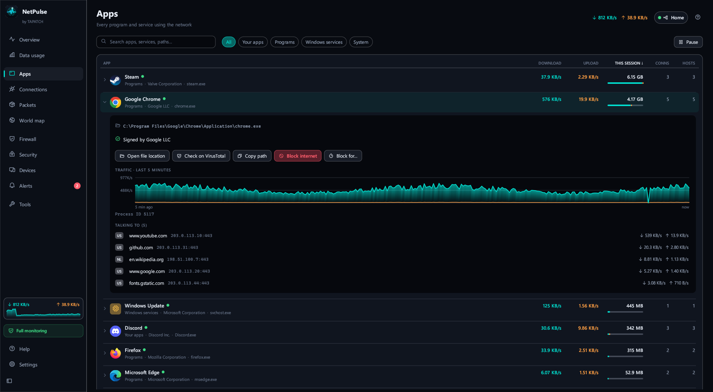
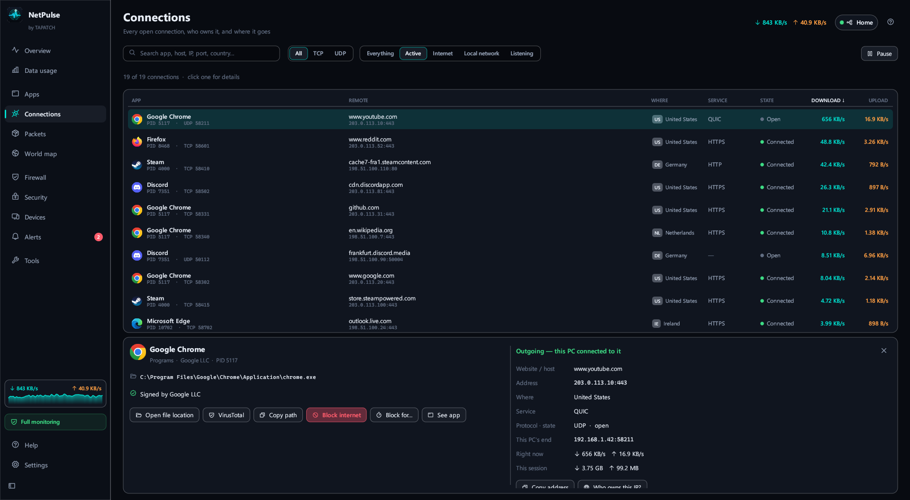
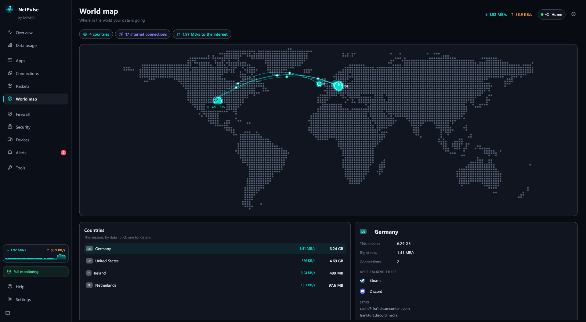
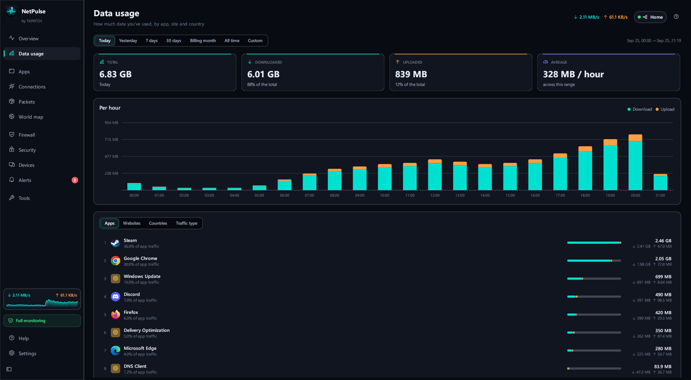
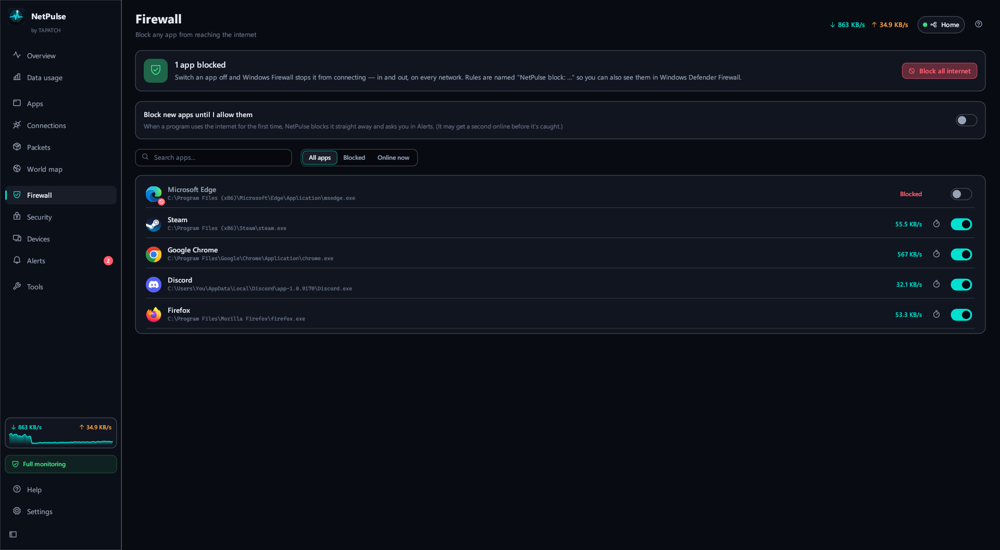
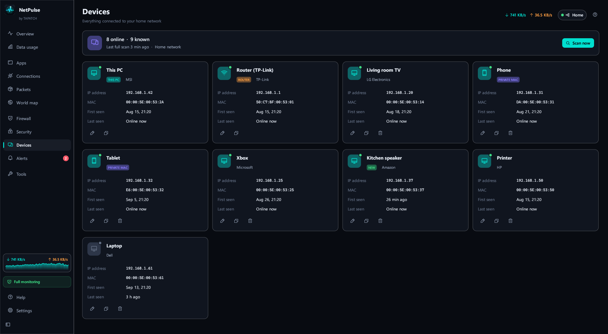

<p align="center"></p>
<h1 align="center">NetPulse</h1>
<p align="center"><b>Every app, every connection, every packet.</b></p>
<p align="center">Network Monitor · Windows 10/11 · x64 · ~12 MB · Free for personal use</p>
<p align="center"><a href="https://github.com/tapatchUSA/NetPulse/releases/latest"><b>⬇ Download NetPulse 1.0.4</b></a> &nbsp;·&nbsp; <a href="https://tapatch.com/tools/netpulse/">tapatch.com/tools/netpulse</a></p>

<p align="center">
<br>
 <br>
 <br>
 <br>
 
</p>

> Most network monitors give you a graph and a guess. NetPulse names the app behind every byte, reads the packets back to you in plain English, and keeps all of it on your PC.

## What it does

NetPulse shows exactly which program is using your internet, how much, and where it goes — from Windows' own kernel network events, so the numbers per app are exact. Keep history as long as you like, block any app in one click, check your network for hijacking and open doors, and capture packets with a plain-English explanation of each one. Everything is measured and stored on your PC: no account, no cloud, no telemetry.

## Features

A network monitor, a firewall and a packet viewer that explains itself — in one app that never phones home.

**📊 Exact traffic per app**  
Real bytes for every program and Windows service, the websites each one looks up, and a live graph per app — straight from the kernel, not estimated.

**📦 Packets, in plain English**  
Capture on every adapter and see which app sent each packet. DNS, website names, HTTP and QUIC are decoded, with a one-line explanation and a hex view.

**🕒 Slide through a capture**  
Drag the timeline to any stretch, sort by any column, and click the breakdown chart to show only the apps, sites or addresses you pick.

**🛡️ One-click firewall**  
Block any app for good or for an hour, hold new apps until you allow them, or cut all internet with one switch.

**🔍 Network security checks**  
Watches for DNS or proxy hijacking, router spoofing, open ports, Remote Desktop and unsigned programs — and alerts you when something changes.

**📈 History as long as you want**  
Usage per app, site and country for any day or custom range, kept until a size you choose. Connection quality logs every outage and whose side it was on.

**🔒 Stays on your PC**  
No account, no cloud, no telemetry. History, alerts and settings live only on this machine.

## Limitations

- Windows 10/11 only. Exact per-app traffic, packet capture, the firewall and the security checks need administrator rights (full monitoring) — without them NetPulse lists connections only. Packet capture sees this PC's own traffic, not other devices on your network, and the contents of HTTPS/QUIC stay encrypted.

## What's new in 1.0.4

- Now runs on any Windows 10 or 11 PC, even a fresh install: it no longer needs the Microsoft Visual C++ Redistributable (no more "VCRUNTIME140.dll was not found")
- Nothing else changed

Release notes for every version are on the [Releases](https://github.com/tapatchUSA/NetPulse/releases) page and in [release-notes/](release-notes/).

## Install

1. Download **NetPulse-Setup-1.0.4.exe** from the [latest release](https://github.com/tapatchUSA/NetPulse/releases/latest) or from [tapatch.com](https://tapatch.com/tools/netpulse/).
2. Run it. The installer and the app come in 10 languages.
3. Accept the Terms of Service on first launch.

Windows may show a SmartScreen warning for new downloads. Click **More info → Run anyway**.

Or with [Scoop](https://scoop.sh):

```powershell
scoop bucket add tapatch https://github.com/tapatchUSA/packages
scoop install tapatch/netpulse
```

## All versions

| Version | Released | Installer | VirusTotal | SHA-256 |
|---|---|---|---|---|
| [1.0.4](https://github.com/tapatchUSA/NetPulse/releases/tag/v1.0.4) | 2026-10-17 | [NetPulse-Setup-1.0.4.exe](https://github.com/tapatchUSA/NetPulse/releases/download/v1.0.4/NetPulse-Setup-1.0.4.exe) | [0 / 71](https://www.virustotal.com/gui/file/be44cc5ddc7186a8f56c40327fb86ceb6e202b377577c4b731634c728e439ca8/detection) | `be44cc5ddc7186a8…` |
| [1.0.3](https://github.com/tapatchUSA/NetPulse/releases/tag/v1.0.3) | 2026-10-01 | [NetPulse-Setup-1.0.3.exe](https://github.com/tapatchUSA/NetPulse/releases/download/v1.0.3/NetPulse-Setup-1.0.3.exe) | [0 / 70](https://www.virustotal.com/gui/file/645818cb2901415e1d54014000b56e145b0aaef34c65871bd26d52841377300d/detection) | `645818cb2901415e…` |
| [1.0.2](https://github.com/tapatchUSA/NetPulse/releases/tag/v1.0.2) | 2026-09-30 | [NetPulse-Setup-1.0.2.exe](https://github.com/tapatchUSA/NetPulse/releases/download/v1.0.2/NetPulse-Setup-1.0.2.exe) | [0 / 62](https://www.virustotal.com/gui/file/16e6f9a5a537c10137002667630efc4d8e1367409717c13a5cc89a489b542d35/detection) | `16e6f9a5a537c101…` |
| [1.0.1](https://github.com/tapatchUSA/NetPulse/releases/tag/v1.0.1) | 2026-09-27 | [NetPulse-Setup-1.0.1.exe](https://github.com/tapatchUSA/NetPulse/releases/download/v1.0.1/NetPulse-Setup-1.0.1.exe) | [0 / 71](https://www.virustotal.com/gui/file/e0b0e8e5c5018e359c88fc35cdaad30280b455ddabf1e7f704293f7a7601e3d1/detection) | `e0b0e8e5c5018e35…` |
| [1.0.0](https://github.com/tapatchUSA/NetPulse/releases/tag/v1.0.0) | 2026-09-25 | [NetPulse-Setup-1.0.0.exe](https://github.com/tapatchUSA/NetPulse/releases/download/v1.0.0/NetPulse-Setup-1.0.0.exe) | [0 / 71](https://www.virustotal.com/gui/file/05345c516a02daa434e29148a0c05164d9b19118fbe6addc2f831ed3b0a39132/detection) | `05345c516a02daa4…` |

## Security

Every installer is scanned on VirusTotal before release. NetPulse 1.0.4: **0 / 71** engines flag it · [view report](https://www.virustotal.com/gui/file/be44cc5ddc7186a8f56c40327fb86ceb6e202b377577c4b731634c728e439ca8/detection)

**SHA-256**
```
be44cc5ddc7186a8f56c40327fb86ceb6e202b377577c4b731634c728e439ca8
```

## Built with

Rust · egui · ETW · SQLite

## License

Free for personal use. Business or commercial use requires a paid license (see [tapatch.com/terms](https://tapatch.com/terms/)). Full terms: [tapatch.com/terms/software](https://tapatch.com/terms/software/).

This repository holds the official installers and release notes.

---

**[tapatch.com](https://tapatch.com)**: small tools, serious quality. Built solo, shipped with care.
