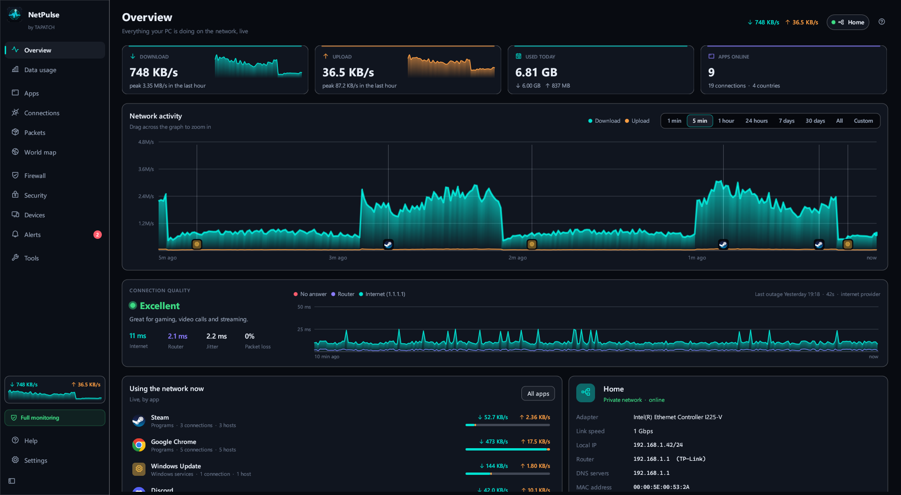
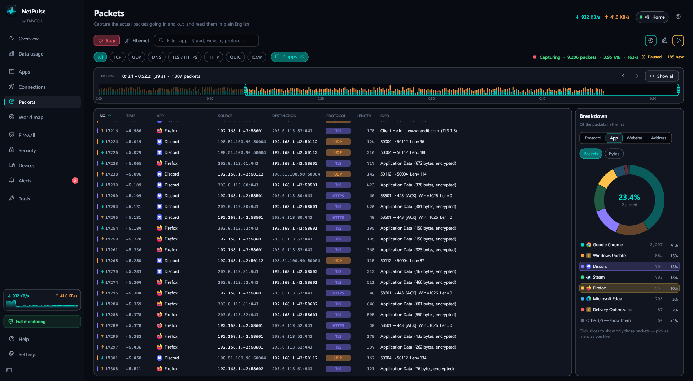
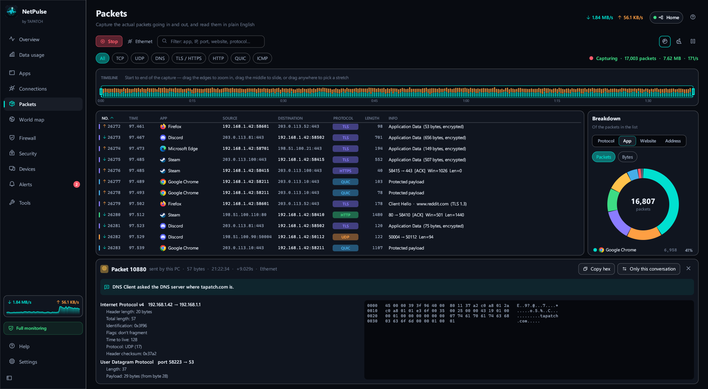
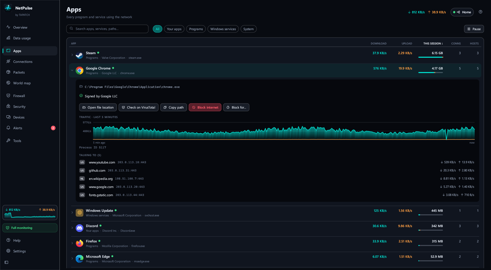
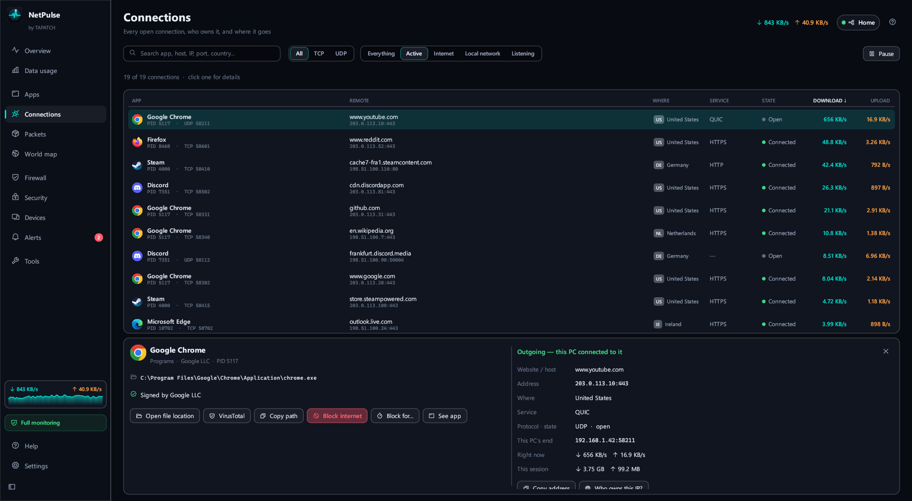
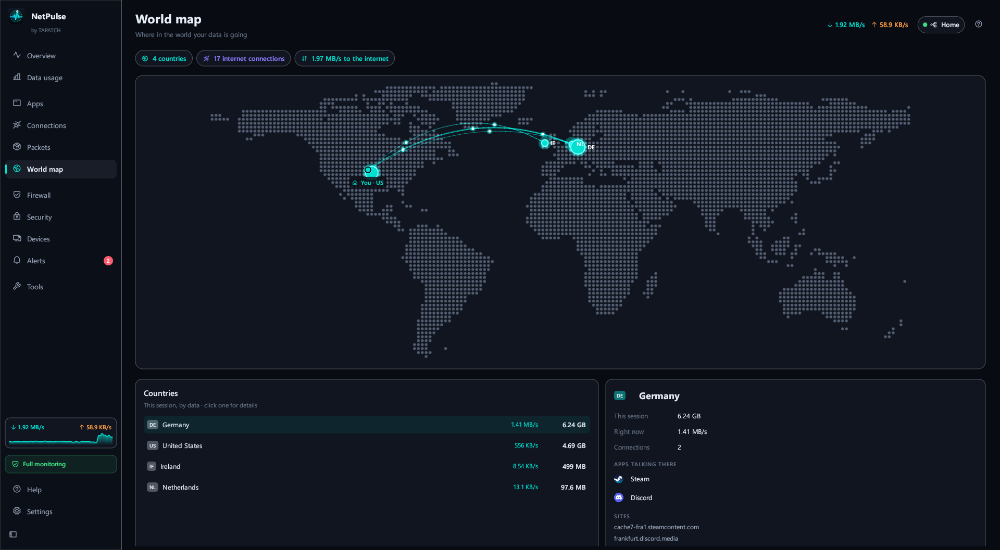
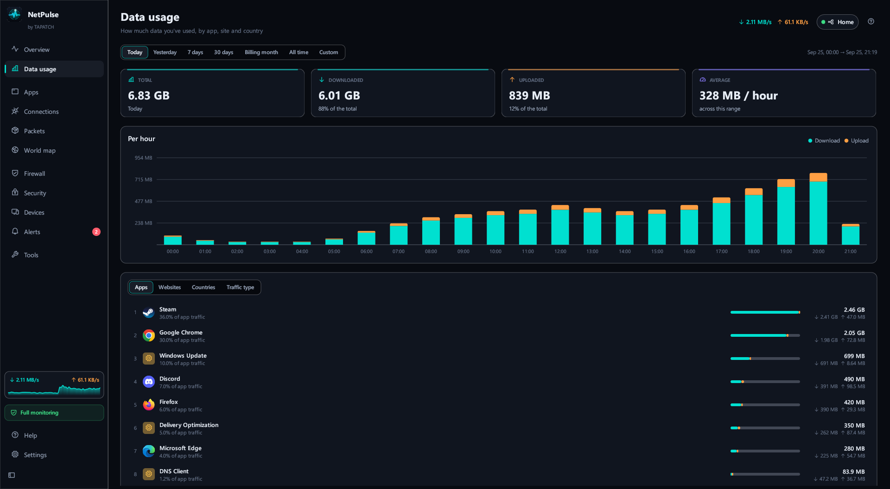
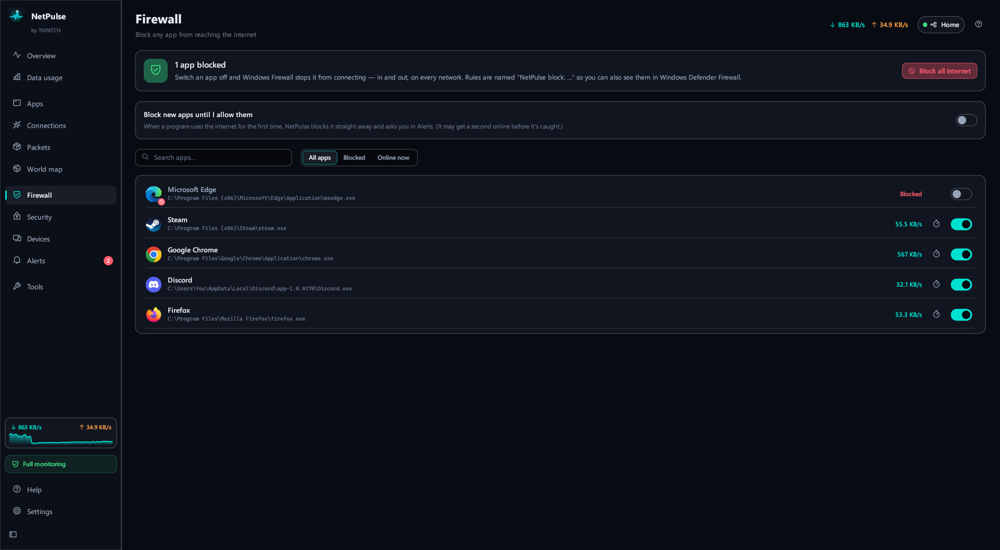
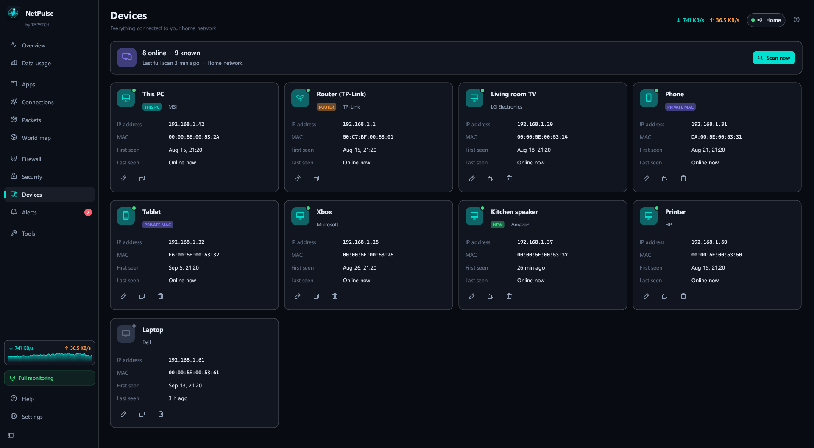

**NetPulse 1.0.5** for Windows 10/11 (x64) · Free for personal use

### What's new

- New Custom theme: pick your own accent, background, panel and text colors
- Background pictures and GIFs: add as many as you like in Settings, tick the ones to show (or Select all), and the ticked ones take turns
- Sliders set how strong the picture is and how see-through the panels are; turn it off any time
- The installer's license text matches the current Terms, and THIRD-PARTY-NOTICES.txt lists the open-source parts it uses

### Screenshots

 
  
  
  
 

### Download

**`NetPulse-Setup-1.0.5.exe`** is attached below. It is the same file as on [tapatch.com/tools/netpulse](https://tapatch.com/tools/netpulse/).

### Security

- VirusTotal: **0 / 71** engines flag it · [view report](https://www.virustotal.com/gui/file/03517ff7f75c26ce8d64af4b65a0516ada25ceb0d14d55c8af21a915a62d3e75/detection)
- SHA-256: `03517ff7f75c26ce8d64af4b65a0516ada25ceb0d14d55c8af21a915a62d3e75`

*First released on tapatch.com on 2026-11-05.*

---
Free for personal use. Business or commercial use requires a paid license (see [tapatch.com/terms](https://tapatch.com/terms/)).
