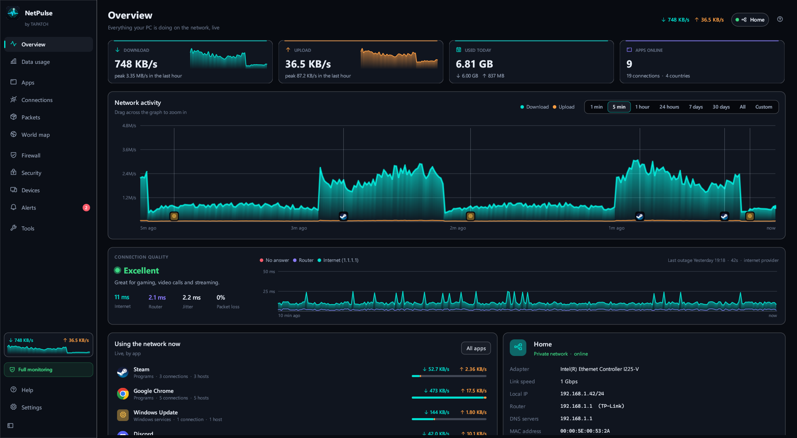
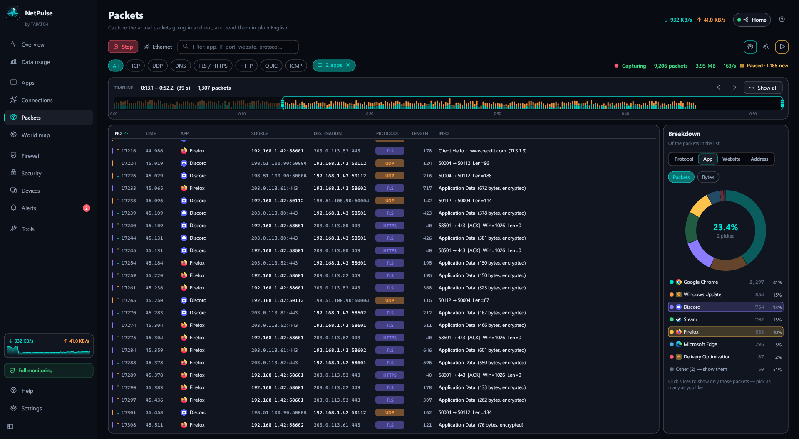
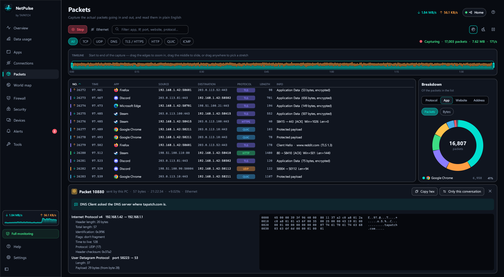
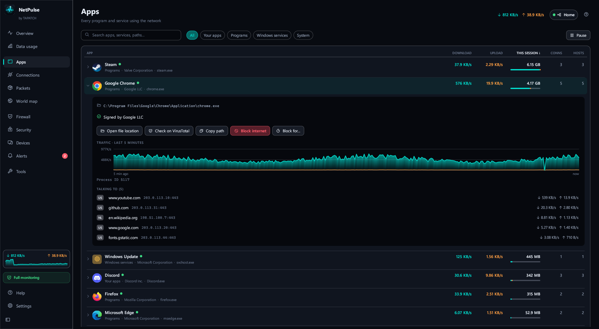
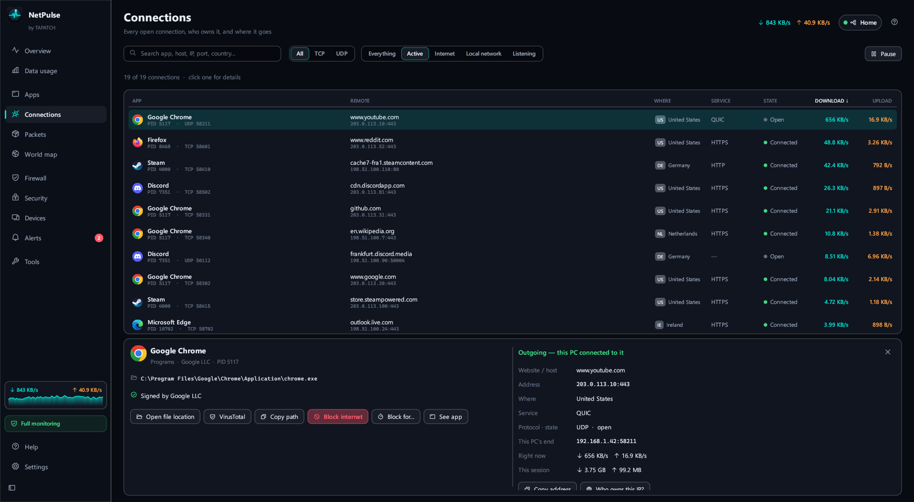
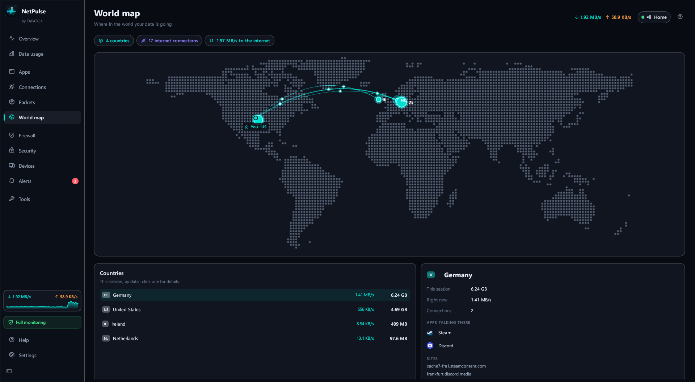
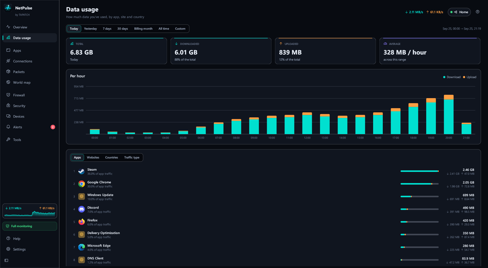
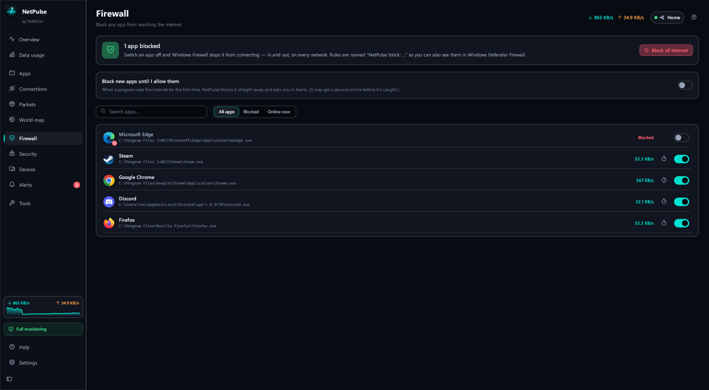
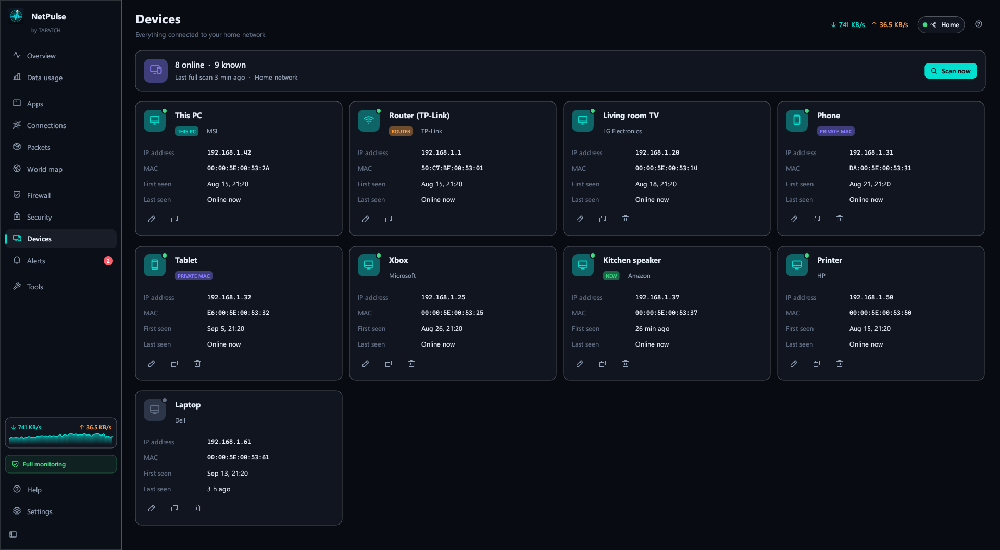

**NetPulse 1.0.6** for Windows 10/11 (x64) · Free for personal use

### What's new

- Device names in DHCP packets no longer end in an empty box when the device pads them with zero characters
- The English text now uses American spelling everywhere

### Screenshots

 
  
  
  
 

### Download

**`NetPulse-Setup-1.0.6.exe`** is attached below. It is the same file as on [tapatch.com/tools/netpulse](https://tapatch.com/tools/netpulse/).

### Security

- VirusTotal: **0 / 71** engines flag it · [view report](https://www.virustotal.com/gui/file/c71bfb9a83cc6b412f1ec94646b88ffc5cdc32ef9c13d93a4a83e77fdd9a9409/detection)
- SHA-256: `c71bfb9a83cc6b412f1ec94646b88ffc5cdc32ef9c13d93a4a83e77fdd9a9409`

*First released on tapatch.com on 2026-11-07.*

---
Free for personal use. Business or commercial use requires a paid license (see [tapatch.com/terms](https://tapatch.com/terms/)).
