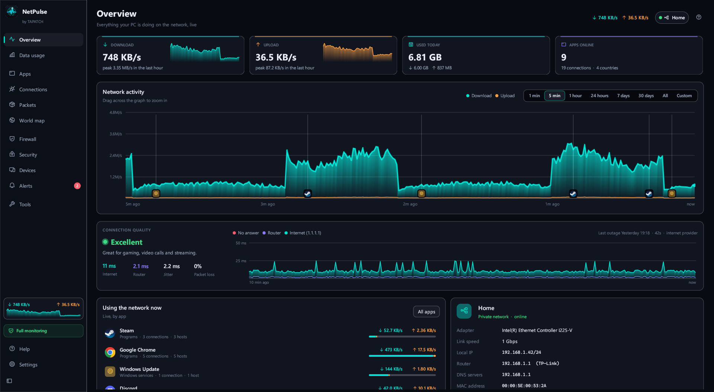
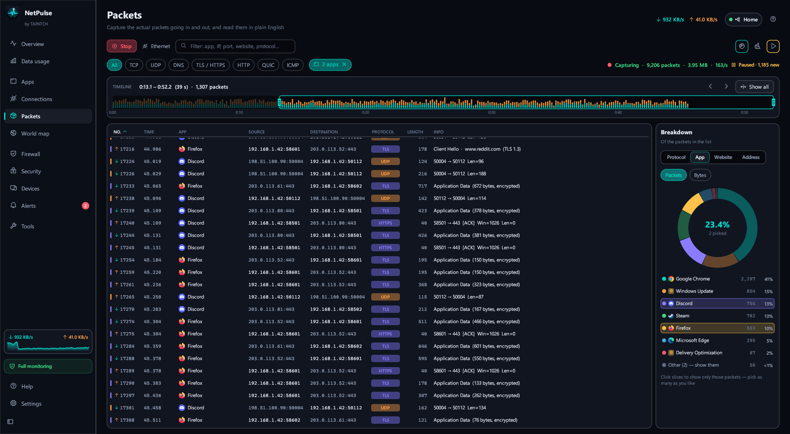
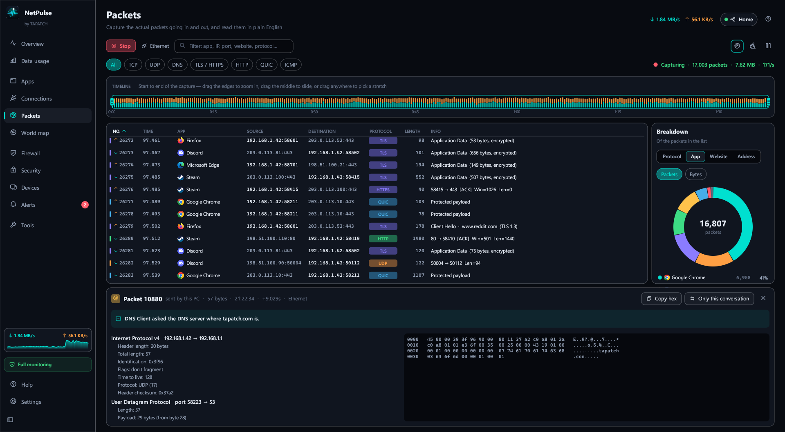
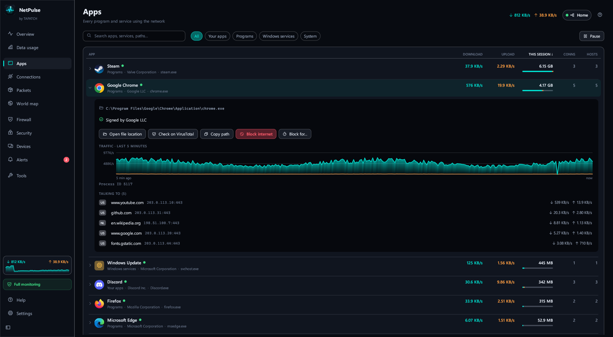
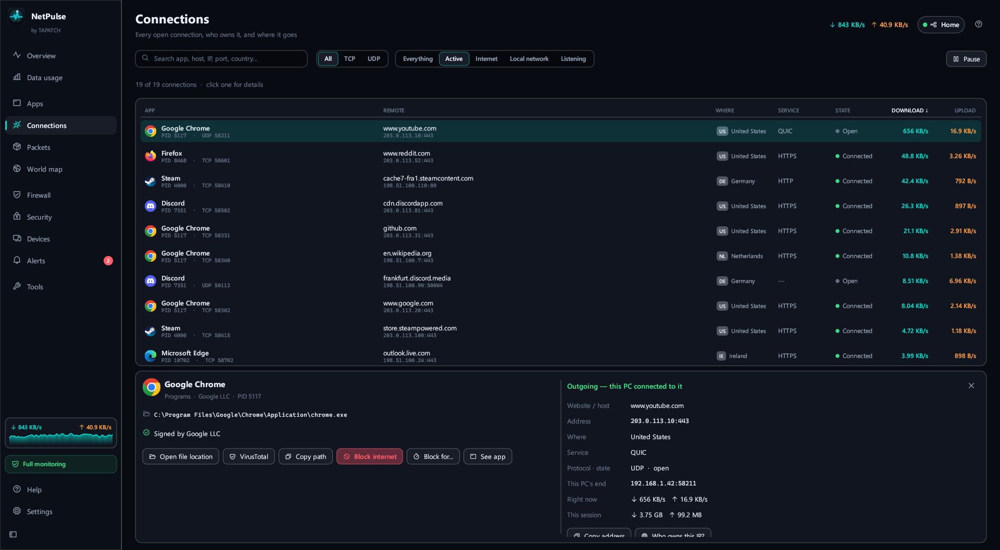
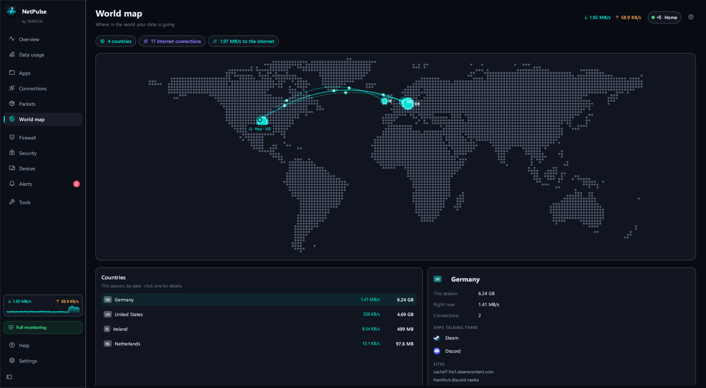
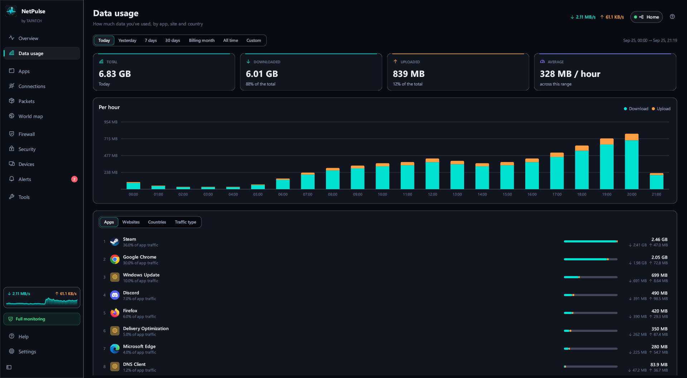
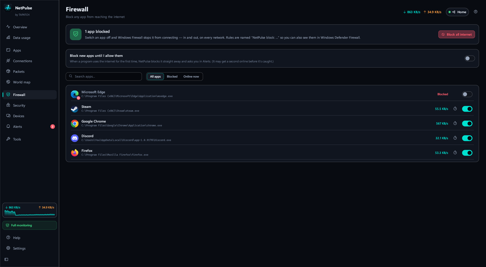
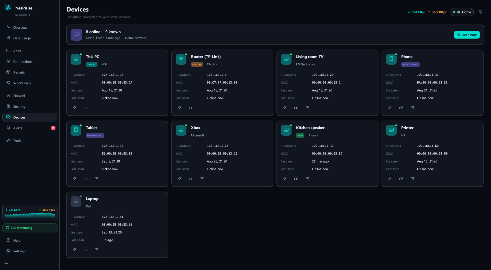

**NetPulse 1.0.8** for Windows 10/11 (x64) · Free for personal use

### What's new

- The text at the top of the Firewall and Security pages no longer runs under the button on the right in smaller windows
- Long values on the Security page now end in … instead of spilling out of the row; hover to see the full text
- The Where column under Connections is wider, and long country names end in … instead of being cut off mid-letter

### Screenshots

 
  
  
  
 

### Video

### Download

**`NetPulse-Setup-1.0.8.exe`** is attached below. It is the same file as on [tapatch.com/tools/netpulse](https://tapatch.com/tools/netpulse/).

### Security

- VirusTotal: **0 / 71** engines flag it · [view report](https://www.virustotal.com/gui/file/373771d758041ec2c55346ff75171fcab6c73a32c29b646b1922b3aa0b94d2dc/detection)
- SHA-256: `373771d758041ec2c55346ff75171fcab6c73a32c29b646b1922b3aa0b94d2dc`

*First released on tapatch.com on 2026-11-18.*

---
Free for personal use. Business or commercial use requires a paid license (see [tapatch.com/terms](https://tapatch.com/terms/)).
